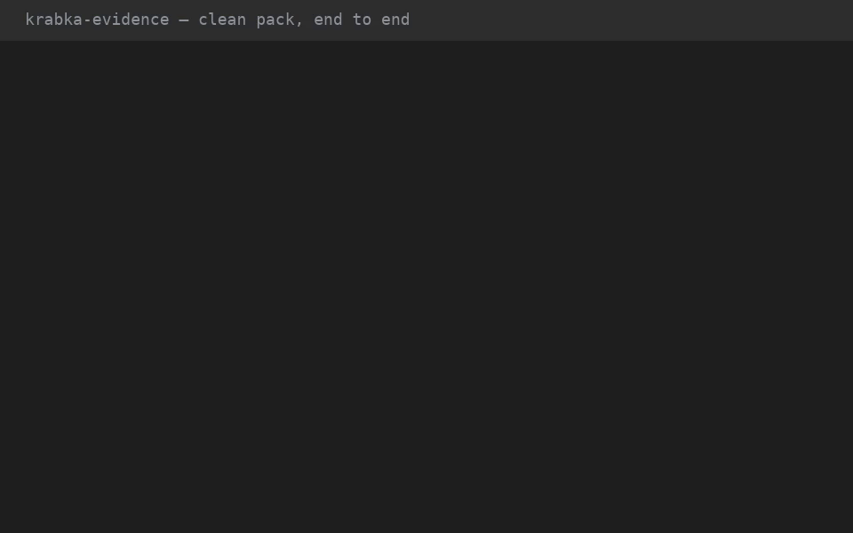
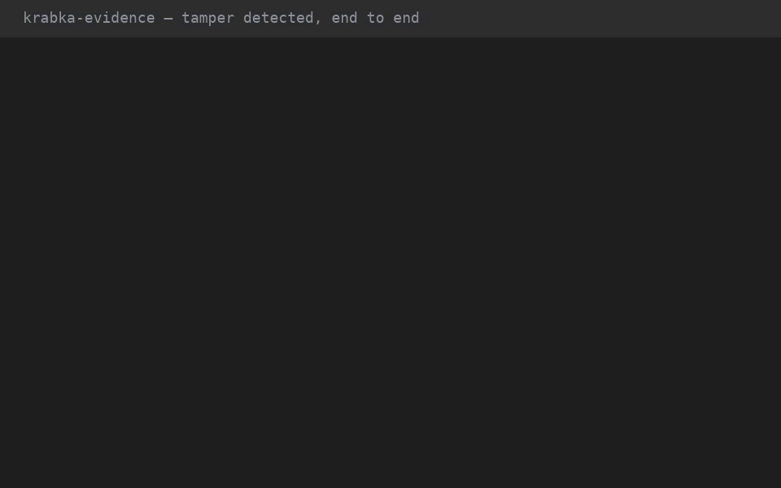

# krabka-evidence: one signed report from every ledger

An offline command-line tool that answers one question: *did every dangerous
thing that happened go through the controls, and can we prove it?*

You give it a time window and copies of the cluster's records — an audit
partition, the `__cluster_metadata` log (or a `krabka-backup` capture), the
tiered WORM archive, and the operator keys file — and it emits one signed
HTML + JSON evidence pack an auditor can re-verify without a broker.

Exit codes: **0** means clean, **1** means findings, **2** means inputs
unreadable. The tool never talks to a live broker and never writes to its
inputs.

## Demos

Two terminal recordings, generated from real runs by `scripts/demo.py` —
the generator executes every filmed command, asserts its exit code and
output, and renders the captured bytes (no staged output):


*Clean: fixture → build → verify ([MP4](docs/demo/demo-clean.mp4))*


*Tamper: a forged signature fails the build, and the finding names its
offset ([MP4](docs/demo/demo-tamper.mp4))*

Regenerate with `python3 scripts/demo.py` (needs `ffmpeg`/`ffprobe` on
PATH — e.g. `nix shell nixpkgs#ffmpeg` — plus a monospace TTF). The
script rebuilds the release binary, runs every filmed command, renders
both formats, and verifies each file: decodes cleanly, 10–15 s long,
animated non-blank frames.

## Quickstart

```sh
# Build synthetic three-ledger inputs (no cluster needed).
krabka-evidence fixture --scenario all --out /tmp/demo

# Build a signed pack from the clean scenario.
krabka-evidence --from 2026-09-01 --to 2026-10-01 \
  --audit /tmp/demo/clean/audit \
  --metadata /tmp/demo/clean/metadata \
  --archive /tmp/demo/clean/archive \
  --operator-keys /tmp/demo/clean/keys/keys.toml \
  --cluster-id fixture-cluster \
  --sign-with /tmp/demo/clean/keys/auditor.priv.pkcs8 \
  -o /tmp/demo/clean/evidence

# Verify the pack (re-checks the signature; optionally re-hashes inputs).
krabka-evidence verify /tmp/demo/clean/evidence
krabka-evidence verify /tmp/demo/clean/evidence --audit /tmp/demo/clean/audit
```

The tamper scenarios each produce exactly one finding: `missing-audit`
(deleted tail segment), `flipped-sig` (forged operator signature under a
re-sealed chain), `approver-change` (mid-window approver drift),
`corrupt-chain` (broken checkpoint signature), `expired-approval`
(approval after expiry), `worm-tamper` (rewritten manifest link).
`unsigned` stays clean with attested-only notes. Each scenario dir holds
a `README.txt` describing its tamper.

## How it works

1. **Per-ledger verifiers.** Runs the shipped verifiers unchanged and copies
   their results into the report: `krabka-audit`'s
   `verify_partition_dir` (chain, checkpoints, declared loss windows),
   `krabka-remote-storage`'s `verify_archive` (manifest chain, object
   digests, orphans), and metadata history coverage.
2. **Timeline.** Turns each ledger into rows of
   `(time, action, target, proposal_id, principal, source)` from audit
   `PrivilegedAction` events, metadata freeze/break-glass records, and
   gated `AdminOperation` events.
3. **Cross-checks.** Joins the ledgers (table below); every finding cites
   both sides by offset.
4. **Report.** Writes `report.json`, `report.sig` (raw 64-byte Ed25519),
   `report.html` (one section per check), and `input-files.json`
   (per-file hashes), then signs the canonical JSON with the auditor key.

All Krabka crates are used as libraries, pinned to release tags
(`krabka-broker` family at `v1.0.5`, `krabka-protocol` family at `0.6.0` —
the same revision the broker's own patch pins, so record types unify).
Signature preimages come from `krabka-guard`'s own functions; the tool
never re-implements a byte layout. Two broker helpers are `pub(crate)`
(the action name/wire tables), so the tool mirrors those 7-line tables
with tests pinning them to declaration order.

## The cross-checks

| Check | Rule | Finding when |
|---|---|---|
| Applied with no audit event | Every metadata freeze / consumed proposal has a matching audit event | The act is missing from the audit trail (fail-open gap) |
| Audited action not in metadata | Every audit `Applied` has a matching metadata record | Forged or replayed event |
| Signature verification | Every operator signature verifies | Bad signature, unknown key, half-signed record |
| Two-person rule | Approvers ≠ proposer, approvals before expiry | Self-approval, double approval, late approval/consumption |
| Bypassed controls | `Bypassed` phases and audit-only recovery listed | Control bypassed, with reason text |
| Approver set changes | Fingerprint stable within the window | Approver set changed mid-window |
| Gated operations | Succeeded `DeleteTopic`/`DeleteRecords` has a prior consumption | Gated op without approval |

Corroboration is phase-aware: a freeze needs an `applied` freeze-path
event, and a consumed proposal needs a `consumed`/`applied` event — an
approval alone proves the approval, not the act.

The report also says what was **not** checked: freeze signatures need
`--cluster-id` (the preimage covers it), checkpoint/manifest signatures
need audit/WORM keys, and snapshots compact history away (reported as
*metadata history not available before offset N*).

## Findings guide

Every finding cites its evidence by offset. First step is always the
same: open `report.html`, read the finding's detail, then pull the cited
offsets from the input copies.

| Finding | Meaning | First step |
|---|---|---|
| Audit hash chain broken | Tampered or corrupt audit copy | Re-copy from quorum reads; compare digests |
| Audit chain has no signed anchor | Records exist, no checkpoint covers them | Check broker checkpointing; treat as unattested |
| Audit declared records lost | Fail-open gap: N records gone | Scope the window; review broker `failure_mode` |
| WORM archive tamper detected | Manifest link, signature, or digest mismatch | Audit store writes; re-run with `--deep` |
| WORM head mismatch | Archive stops short of `--expect-head` | Finish the copy; check the expected value |
| WORM orphan objects | Objects no manifest names (`--strict-orphans`) | Look for partial or concurrent writes |
| Metadata history not available | Retention/snapshot floor before offset N | Add older inputs, or scope the window above N |
| Applied with no audit event | The act is missing from the audit trail | Check the broker audit sink for the gap |
| Audited action not in metadata | Forged or replayed event | Investigate; rule out snapshot compaction first |
| Audit event predates proposal | Event stamped before creation | Check clock skew, then forgery |
| Signature does not verify | Bad bytes, half-signed record, or forgery | Re-copy; check key rotation |
| Unknown key | `key_id` outside the trust set | Provision the key, or investigate |
| Signature timestamp after emit | Operator stamp is in the event's future | Check clock skew, then forgery |
| Two-person rule violated | Quorum, timing, or withdrawal breach | Review the proposal's approvals |
| Gated action bypassed approval | A `bypassed` phase ran | Review the reason text |
| Unclean recovery ran audit-only | Recovery without quorum evidence | Review the recovery record |
| Approver set changed | Membership drift mid-window | Expected during rotation; else investigate |
| Gated op without approval | Deletion with no prior consumption | Investigate the operation |

Notes (as opposed to findings) record coverage limits — unattested
records, compacted history, skipped inputs — without failing the run.
A `not-checked` row means the check could not run at all; treat it as
a gap, and gate CI on `--require-all-checked`.

## Keys

The keys file carries the same `[[operator_keys]]` table that
`krabka-guard freeze list --verify-signatures --operator-keys` takes, plus
optional broker-key tables for the checkpoint and manifest signatures:

```toml
[[operator_keys]]
key_id = "alice-2026"
principal = "User:alice"
public_key_path = "alice.pub"   # raw 32 bytes, relative to this file

[[audit_keys]]
key_id = "audit-1"
public_key_path = "audit.pub"

[[worm_keys]]
key_id = "worm-1"
public_key_path = "worm.pub"
```

CLI flags can add broker keys instead: `--audit-key-id` with
`--audit-public-key` (single, like `krabka-audit verify`), and repeatable
`--worm-key-id`/`--worm-public-key` pairs (like `krabka-worm-verify`).

The report key is a separate auditor key the cluster never sees. Mint one
with `krabka-evidence keygen --out auditor`, then sign with
`--sign-with auditor.priv.pkcs8 --auditor-key-id auditor-1`.

## CLI reference

```sh
krabka-evidence --from 2026-09-01 --to 2026-10-01 \
  --audit ./audit-partition --metadata ./cluster-metadata \
  --archive s3://bucket/tiered --operator-keys keys.toml \
  --cluster-id ID --sign-with auditor.priv.pkcs8 -o evidence/
krabka-evidence verify evidence/ [--auditor-public-key key.pub] \
  [--audit ... --metadata ... --archive ...]
krabka-evidence keygen --out auditor
krabka-evidence fixture --scenario all --out /tmp/demo
```

`--from`/`--to` accept `YYYY-MM-DD`, RFC 3339, or epoch millis. `--metadata` accepts a
segment directory, a snapshot directory, or a `krabka-backup` capture
(`restore-inputs/…`). `--archive` accepts a local directory or an
`s3://bucket[/prefix]` URL (`--s3-region`, `--s3-endpoint`,
`--allow-http`; credentials come from the ambient AWS chain).
`--expect-head` pins the WORM tip; `--deep` recomputes every object
digest; `--strict-orphans` fails on orphan objects;
`--allow-epoch-restarts` accepts chain restarts.

## Troubleshooting

Every exit-2 error is followed by a `hint:` line with the fix. The
common ones:

| Error | Fix |
|---|---|
| `refusing to write the pack … nests with the input` | Move `-o` outside every input directory |
| `… is N bytes, over --max-segment-bytes M` | Raise the flag, or check for a runaway file |
| `archive verification timed out after Ns` | Raise `--archive-timeout-secs`; check endpoint and credentials |
| `no [[operator_keys]], [[audit_keys]], or [[worm_keys]] entries` | Provision at least one key table |
| `at most one audit key is supported` | Keep a single `[[audit_keys]]` entry |
| `… NOT CHECKED: no [[audit_keys]] entry` | Add audit keys (file or `--audit-key-id`/`--audit-public-key`) |
| `freeze signatures NOT CHECKED` | Pass `--cluster-id` |
| `pack was written by X; this verifier is Y` | Re-run with matching tool versions |
| `FAIL: … input digest differs from the pack's record` | The input changed since the build; re-copy the original |
| `not a directory and not an s3:// URL` | Fix `--archive` (path or `s3://bucket[/prefix]`) |
| S3 access errors | Check the ambient AWS chain (`AWS_*`, role, `--s3-endpoint`) |

## Development

```sh
./scripts/check.sh            # fmt --check, clippy -D warnings, full suite
./scripts/check-latest-tag.sh # newest broker tag still builds
```

CI runs the same, plus `cargo doc` and the tag-freshness job. Tests live
in `tests/`: `scenarios.rs` (the PRD success criteria end to end),
`cross_checks.rs` (one behavior proof per check), `robustness.rs`
(reader limits), `cli.rs` (flags and subcommands), `units.rs` (tables,
parsing, goldens), `perf.rs` (throughput floor).

Release builds measured ~133k audit records/s on test hardware — 10M
records in ~75s, four times inside the 5-minute budget.

## Limitations (honest)

- The tool checks the ledgers it is given, nothing else: broker config
  (`failure_mode`, `background_unclean_recovery`), live quorum state, and
  controls outside the three ledgers are out of scope, and the report says
  what was checked and what was not.
- Gated-operation matching covers topic/record deletion (the PRD's named
  set); other admin operations are out of scope.
- Approval audit events are verified against the metadata proposal they
  name; a proposal compacted away by a snapshot cannot corroborate them.
- `verify` trusts the auditor key embedded in the pack unless
  `--auditor-public-key` pins it.

## License

Licensed under the Apache License, Version 2.0. See [LICENSE](LICENSE).
